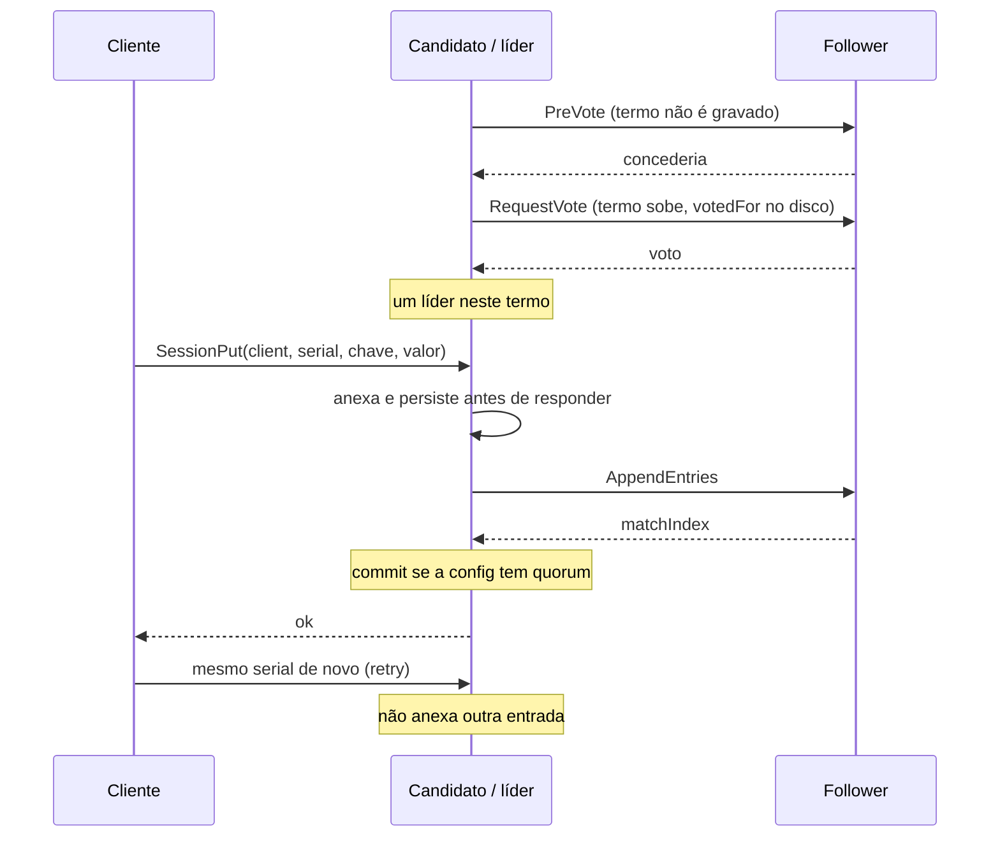
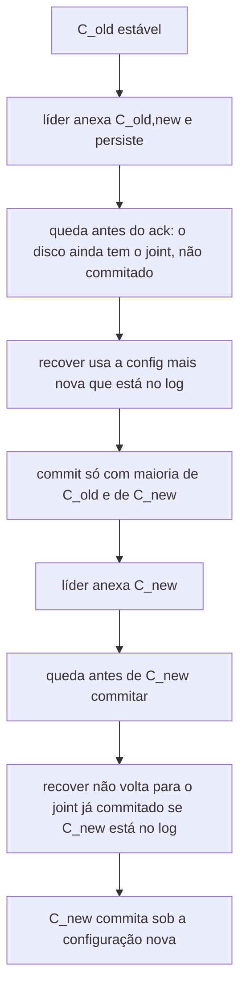
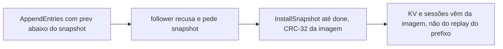

# raft-mvp

Implementação didática do protocolo [Raft](https://raft.github.io/raft.pdf) (Ongaro e Ousterhout) em Rust. Um processo é um servidor. O cliente fala TCP. O log é a fonte da verdade do KV.

Versão **1000000.0.0**. Esse número foi pedido de propósito. Não é maturidade de produção, não é compatibilidade com etcd e não muda o formato em disco (continua a versão 1, `RAFT` + CRC-32). Não há número de throughput, latência ou tempo de eleição neste repositório.

## O que isto é — e o que não é

Isto **é** um Raft de um grupo só, com eleição, replicação, persistência, snapshot (com CRC-32 da imagem), mudança de membership, um KV aplicado do log e um anel de eventos do protocolo consultável por `trace`. Serve para ler o protocolo ao lado do código e para falhar um nó de propósito.

Isto **não é**:

- **etcd**, Consul, TiKV ou um drop-in desses sistemas. Não há gRPC, watch, lease, transação multi-key, autenticação, TLS nem descoberta de membros.
- um cluster de produção. Não há multi-raft, witness sem log, nem tolerância a falta bizantina.
- um benchmark. Se um teste mede alguma coisa, a medida é uma asserção de estrutura (índice, termo, conteúdo), nunca um número de desempenho publicado.

O transporte é TCP com length-prefix e `bincode`, de propósito: o frame cabe num teste sem codegen, e um follower atrasado se recupera por `InstallSnapshot`, não por um RPC opaco.

## Por que o protocolo está desenhado assim

Raft separa três problemas que um líder único resolve em ordem.

1. **Quem decide.** Cada termo tem no máximo um líder. O voto exige log tão atualizado quanto o do candidato. Pre-vote existe para um nó isolado não inflar o termo e derrubar um líder que ainda tem quorum: a campanha só vira eleição de verdade depois de um quorum de "eu votaria".
2. **O que ficou decidido.** Uma entrada commitada está em uma maioria da configuração vigente e, no líder, pertence ao termo atual (a regra que impede o líder de commit de entrada antiga). O KV só aplica até `commitIndex`. Um `Put` comum não é idempotente. Um `SessionPut` é: o par `(client_id, serial)` entra no log no máximo uma vez, e o retry do mesmo serial não troca o valor.
3. **Quem faz parte.** Trocar o conjunto de votantes num passo só abre uma janela em que duas maiorias disjuntas elegem dois líderes. A mudança passa por **C_old,new** (consenso conjunto: maioria do conjunto velho *e* maioria do conjunto novo) e só depois o líder anexa **C_new**. Learner recebe log e não vota até ser promovido.

Leitura linearizável não usa lease de relógio. `Get` faz read index: o líder só responde depois de um quorum de heartbeat no termo em que é líder. `RawGet` lê a memória local e **não** é linearizável. Está na CLI só para contrastar.

Check-quorum, no processo TCP, tira o líder que perdeu contato com a maioria **sem** subir o termo. O simulador determinístico não arma esse timer.

## Fluxo

Eleição e uma escrita com sessão:



Membership, inclusive quando o processo cai no meio:



Follower cujo prefixo o líder já compactou:



## O que roda de verdade

| Caminho | Onde |
|---|---|
| Núcleo (papel, log, commit, config) | `src/raft/` |
| Disco `raft-state.bin` | `src/storage.rs` |
| KV + sessão | `src/kv.rs`, `src/client.rs` |
| TCP | `src/transport.rs`, `src/node.rs` |
| Simulador de tick, sem relógio de parede | `src/sim.rs` |
| Anel de eventos do protocolo | `src/observe.rs` (`trace`) |
| CLI | binário `raft-node` em `src/main.rs` |

Dois modos compartilham `RaftCore`. O nó TCP persiste em disco. O simulador usa armazenamento só em memória, então o teste de recover não passa por ele.

## Instalação

Rust estável, edição 2021. Sem serviço externo.

```bash
cargo test
cargo fmt --all -- --check
cargo clippy --locked --all-targets -- -D warnings
cargo build --release
```

O CI (`.github/workflows/ci.yml`) roda os três primeiros em push e pull request.

## CLI

Os subcomandos abaixo são os do `clap` em `src/main.rs`. `put` **não** disca o `leader_hint`: se o endereço não for o líder, a resposta traz o id e o processo sai com erro. Fale com o líder, ou use o endereço que `status` indicar.

```bash
# três servidores. learners e snapshot automático são opcionais.
cargo run --bin raft-node -- serve \
  --id 1 --bind 127.0.0.1:7001 \
  --peers 2=127.0.0.1:7002,3=127.0.0.1:7003 \
  --data-dir /tmp/raft/n1

cargo run --bin raft-node -- serve \
  --id 2 --bind 127.0.0.1:7002 \
  --peers 1=127.0.0.1:7001,3=127.0.0.1:7003 \
  --learners 4=127.0.0.1:7004 \
  --snapshot-threshold 0 \
  --data-dir /tmp/raft/n2

cargo run --bin raft-node -- status --addr 127.0.0.1:7001
cargo run --bin raft-node -- metrics --addr 127.0.0.1:7001
cargo run --bin raft-node -- trace --addr 127.0.0.1:7001
cargo run --bin raft-node -- put --addr 127.0.0.1:7001 hello mundo
cargo run --bin raft-node -- get --addr 127.0.0.1:7001 hello
cargo run --bin raft-node -- session-put \
  --addr 127.0.0.1:7001 --client-id 7 --serial 1 saldo 10
cargo run --bin raft-node -- membership \
  --addr 127.0.0.1:7001 --voters 1,2,3 --learners 4
cargo run --bin raft-node -- promote --addr 127.0.0.1:7001 --id 4
cargo run --bin raft-node -- transfer --addr 127.0.0.1:7001 --target 2
```

`--snapshot-threshold 0` desliga a compactação automática. Um valor N compacta quando há N entradas commitadas acima do snapshot. `promote` recusa learner com `match_index` atrás do log; `membership` é a proposta explícita e não faz essa trava. `client-id` 0 é recusado.

O script `scripts/demo_3nodes.sh` sobe três processos em `127.0.0.1`. É TCP de verdade neste host. Não simula datacenter nem rede parcial.

## Testes

`cargo test` é a suíte. Os nomes em `tests/invariants.rs` continuam sendo o contrato da 1.1.1. A 1000000.0.0 acrescenta `tests/trace_snapshot.rs`:

| Teste | Invariante |
|---|---|
| `recover_reloads_term_vote_log_and_applied_kv` | termo, voto, log e KV commitado voltam do disco; contadores do processo não |
| `joint_transition_survives_crash_between_c_old_and_c_new` | C_old → joint → C_new com queda antes do commit do joint e de novo antes do commit de C_new |
| `lagged_follower_refuses_prefix_and_recovers_only_by_install_snapshot` | prefixo compactado não volta por AppendEntries |
| `session_retry_does_not_duplicate_and_read_sees_one_value` | retry do mesmo serial não duplica; `Get` vê um valor |
| `at_most_one_leader_per_term_in_simulator` | o simulador não registra dois líderes no mesmo termo |
| `corrupted_snapshot_is_refused_without_truncating` | CRC-32 da imagem não fecha: o follower não trunca o log nem troca o KV |
| `trace_records_term_election_and_commit` | `trace` lista termo, eleição e commit deste processo |
| `partitioned_node_lags_then_matches_commit_after_heal` | nó isolado fica atrás do commit da maioria e alcança depois do heal |

O restante (`tests/protocol.rs`, `tests/expansion.rs`, `tests/crash_recovery.rs`, eleição, replicação, partição) continua valendo, inclusive as seeds **1..=80** do simulador.

## Limitações

- Um cluster de um nó não se remove sozinho.
- Frame TCP máximo: 16 MiB.
- Check-quorum não roda dentro do simulador.
- `snapshot_bytes` soma imagem, envio e recepção, inclusive reenvio. Não é vazão.
- Contadores (`commits`, `elections`, `snapshot_bytes`) morrem com o processo.
- Não há lease de leitura.
- Segunda mudança de membership espera a anterior commitada, inclusive o C_new.
- O simulador não usa o disco. Crash-safe está nos testes que reabrem `Storage`.
- `trace` é um buffer circular só na memória do processo. Não vai para o disco e não é um endpoint Prometheus.
- O checksum do `InstallSnapshot` é o CRC-32 da imagem inteira, o mesmo em cada fatia. Não autentica o remetente. Imagem que não fecha é recusada; o log local fica.

Arquitetura: [`docs/ARQUITETURA.md`](docs/ARQUITETURA.md). RPCs e invariantes: [`docs/PROTOCOLO.md`](docs/PROTOCOLO.md). Disco: [`docs/SPEC.md`](docs/SPEC.md). Stack: [`docs/TECNOLOGIAS.md`](docs/TECNOLOGIAS.md). Histórico: [`CHANGELOG.md`](CHANGELOG.md). Como contribuir: [`CONTRIBUTING.md`](CONTRIBUTING.md).

## Licença

MIT. Copyright (c) 2026 Geraliza Castlevania.
