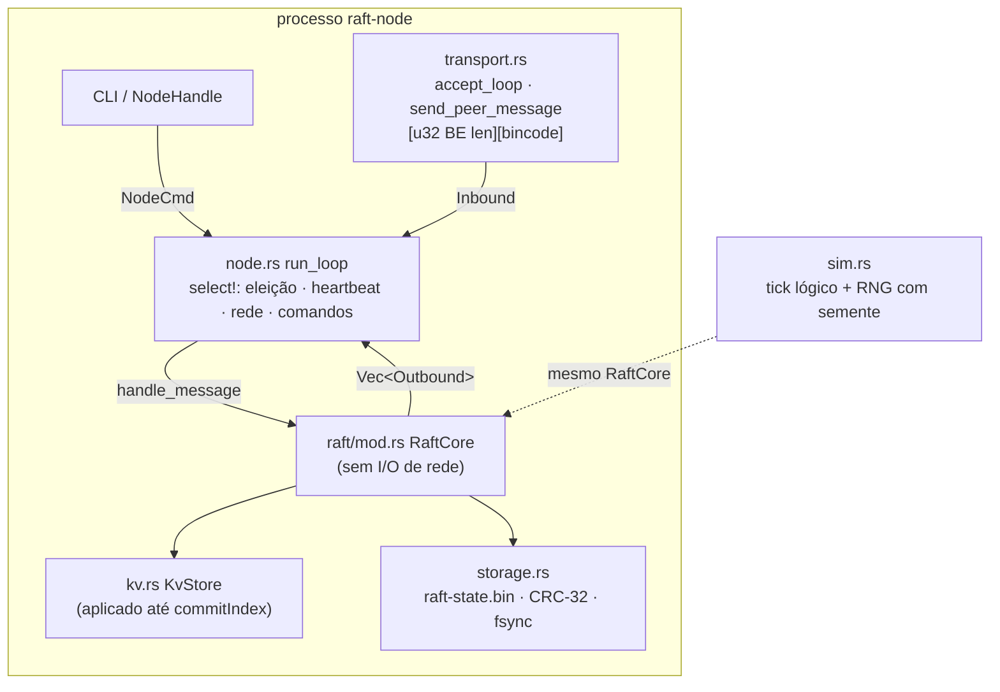
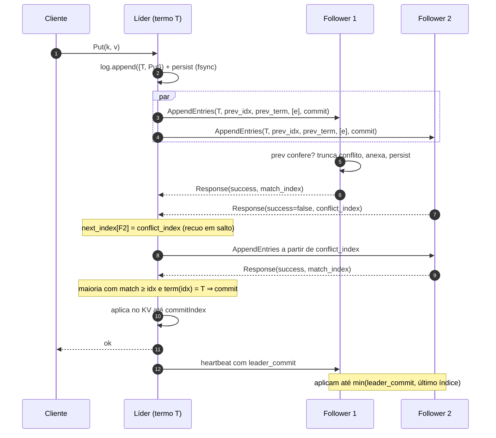
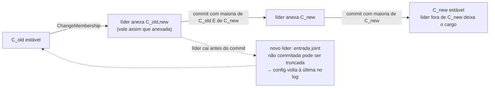
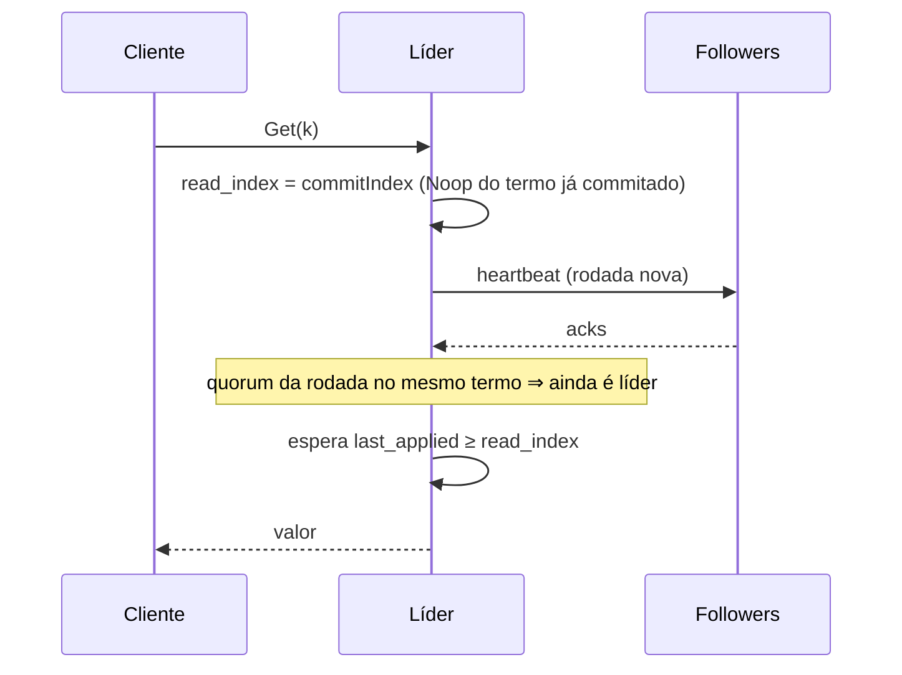

# Arquitetura do raft-kv-rs

Visão de engenharia do código em `main`. Complementa [ARQUITETURA.md](ARQUITETURA.md) (modos de execução) e [PROTOCOLO.md](PROTOCOLO.md) (formato de fio). Referências: Ongaro & Ousterhout, *In Search of an Understandable Consensus Algorithm* (Fig. 2, Fig. 13) e a tese de Ongaro (§4 membership, §6.4 read index, §9.6 pre-vote).

## 1. Camadas



`RaftCore` é uma máquina de estados pura em relação à rede: recebe uma mensagem ou um tick e devolve `Outbound` (`Send`, `ClientReply`, `ClientWaitCommit`, `ClientWaitRead`, `Reset*Timer`, `ForceElectionTimeout`). Por isso o mesmo núcleo roda no processo TCP e no simulador determinístico.

| Módulo | Responsabilidade |
|---|---|
| `raft/mod.rs` | papéis, termos, AppendEntries, InstallSnapshot em chunks, read index, check-quorum, TimeoutNow |
| `raft/log.rs` | log com offset de snapshot, `term_at`, truncamento, compactação |
| `raft/config.rs`, `quorum.rs` | `Stable` / `Joint`, quorum duplo em C_old,new |
| `pre_vote.rs`, `raft/election.rs` | pre-vote sem gravar termo, regra de log atualizado |
| `storage.rs` | imagem única versionada com CRC-32, gravação atômica, injeção de crash |
| `kv.rs`, `client.rs` | KV aplicado do log, dedup `(client_id, serial)` |
| `observe.rs` | anel de eventos do protocolo (`trace`) |

## 2. Estados de um nó

```mermaid
stateDiagram-v2
    [*] --> Follower
    Follower --> PreCandidate: timeout de eleição<br/>(sem notícia do líder)
    PreCandidate --> Follower: pre-vote sem quorum<br/>(termo não sobe)
    PreCandidate --> Candidate: quorum de "eu votaria"
    Follower --> Candidate: TimeoutNow do líder<br/>(pula pre-vote)
    Candidate --> Candidate: timeout (novo termo)
    Candidate --> Leader: quorum de votos<br/>(na config vigente; joint = dois quoruns)
    Candidate --> Follower: AppendEntries/termo maior
    Leader --> Follower: termo maior · check-quorum falhou
    Learner --> Follower: promovido (PromoteLearner)
    note right of Leader
        anexa Noop do termo ao assumir;
        só commita entradas do termo atual (§5.4.2)
    end note
```



`PreCandidate` não é uma variante de `Role`: é o candidato com `pre_vote` ativo e termo intacto. Learner nunca faz campanha.

## 3. Replicação (AppendEntries)



Se o follower está atrás do início do log do líder (`need_snapshot`), o líder troca para InstallSnapshot.

## 4. Snapshot em chunks (InstallSnapshot)

```mermaid
sequenceDiagram
    participant L as Líder
    participant F as Follower atrasado
    L->>L: imagem = KV + sessões + config @ last_included (CRC-32)
    loop cada chunk (snapshot_chunk_size)
        L->>F: InstallSnapshot(T, last_idx, last_term, offset, data, config, done)
        F->>F: termo ok? offset contíguo? acumula (log intocado)
        F-->>L: Response(term, next offset)
    end
    L->>F: último chunk (done = true)
    F->>F: confere CRC; se last_idx ≤ commit, ignora (etcd restore)
    F->>F: mantém sufixo só se term_at(last_idx) == last_term, senão descarta o log
    F->>F: substitui KV, config, persist
    F-->>L: Response(match = last_idx)
    L->>F: AppendEntries a partir de last_idx + 1
```

## 5. Mudança de membership (consenso conjunto)



Regras no código: um único joint por vez; a config vigente é a última entrada `ChangeConfig` do log (commitada ou não); learner recebe log e não conta para quorum até `PromoteLearner`, que exige `match_index` em dia.

## 6. Leitura linearizável (read index)



> Nota: em `cd0599d` o líder ainda não exige o Noop do termo commitado nem uma rodada nova de acks antes de responder; a correção está no PR #3 (`fix/read-index-linearizable`). O diagrama mostra o comportamento depois dele.

`RawGet` lê a memória local e não é linearizável; existe só para contraste.

## 7. Durabilidade

Antes de responder qualquer RPC que mude `currentTerm`, `votedFor` ou o log, o nó grava `raft-state.bin` (magic `RAFT`, versão 1, CRC-32) via arquivo temporário + rename + fsync. `CrashPolicy` injeta queda na N-ésima gravação para os testes de recuperação.

## 8. Rodando

### Local (3 processos)

```sh
cargo build --release
B=target/release/raft-node
$B serve --id 1 --bind 127.0.0.1:7001 --peers 2=127.0.0.1:7002,3=127.0.0.1:7003 --data-dir /tmp/r1 &
$B serve --id 2 --bind 127.0.0.1:7002 --peers 1=127.0.0.1:7001,3=127.0.0.1:7003 --data-dir /tmp/r2 &
$B serve --id 3 --bind 127.0.0.1:7003 --peers 1=127.0.0.1:7001,2=127.0.0.1:7002 --data-dir /tmp/r3 &
$B status --addr 127.0.0.1:7001
$B put --addr 127.0.0.1:7001 cor azul        # em follower: erro com leader_hint
$B get --addr 127.0.0.1:7002 cor
$B session-put --addr 127.0.0.1:7001 --client-id 7 --serial 1 k v   # idempotente
$B transfer --addr 127.0.0.1:7001 --target 2
$B trace --addr 127.0.0.1:7002
```

### Docker Compose

```sh
docker compose up --build -d
docker compose exec n1 raft-node status --addr 172.28.0.11:7000
docker compose stop n1          # derruba o líder; os outros elegem outro
docker compose exec n2 raft-node status --addr 172.28.0.12:7000
docker compose start n1         # volta e alcança por AppendEntries/InstallSnapshot
```

O CLI só aceita `SocketAddr` (sem DNS), por isso o compose fixa IPs numa rede própria (`172.28.0.0/24`). Os dados ficam em volumes nomeados, então `docker compose restart` preserva termo, voto e log.

## 9. Onde testar cada garantia

| Garantia | Teste |
|---|---|
| um líder por termo, log matching (80 seeds) | `tests/protocol.rs` · `sim::check_seed` |
| membership sob perda | `sim::check_membership_under_loss` |
| minoria não commita | `tests/partition_safety.rs` |
| recuperação após crash na gravação | `tests/crash_recovery.rs` |
| snapshot em chunks e trace | `tests/trace_snapshot.rs` |
| invariantes declaradas | `tests/invariants.rs`, `tests/VECTORS.md` |
