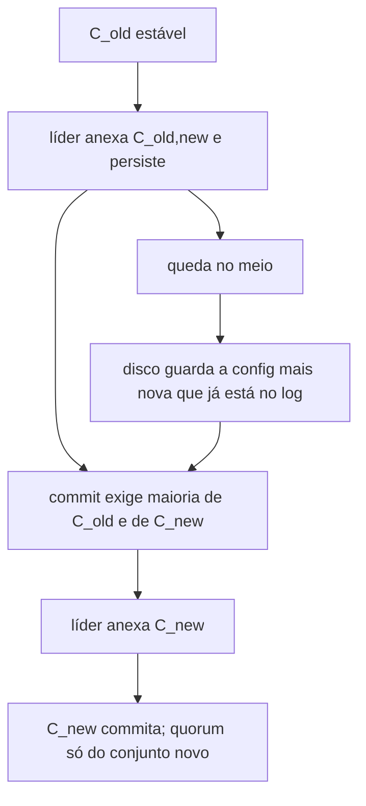

# Protocolo — raft-kv-rs 1000000.0.0

O que o núcleo faz com cada RPC, e as invariantes que os testes seguram. A versão 1000000.0.0 foi pedida; não significa produção. Disco continua na versão 1 (`docs/SPEC.md`). Não há número de throughput, latência ou tempo de eleição.

## RPCs

| Mensagem | Quem envia | Efeito que importa |
|---|---|---|
| `PreVote` / `PreVoteResponse` | candidato, antes de gravar termo | não altera `currentTerm` nem `votedFor` |
| `RequestVote` / `RequestVoteResponse` | candidato | voto só se o log do candidato não está atrás; learner não vota |
| `AppendEntries` / `AppendEntriesResponse` | líder | lote até `max_batch`; `matchIndex` só anda no ack; `need_snapshot` quando o prefixo sumiu |
| `InstallSnapshot` / `InstallSnapshotResponse` | líder | fatias `offset`/`done`; log só trunca no `done` **e** se o CRC-32 da imagem fecha |
| `TimeoutNow` | líder, alvo em dia | alvo faz pre-vote; pre-vote perdido não sobe termo |
| `Client` | cliente | `Put`, `Get` (read index), `RawGet`, `SessionPut`, `ChangeMembership`, `PromoteLearner`, `TransferLeadership` |
| `StatusRequest` | CLI `status` | papel, termo, commit, contadores do processo |
| `MetricsRequest` | CLI `metrics` | os mesmos contadores, sem taxa |
| `TraceRequest` | CLI `trace` | linhas `seq kind term index` do anel em memória |

O frame é `u32` BE + bincode. Teto 16 MiB no TCP.

## Invariantes

1. **Um líder por termo.** O simulador registra o primeiro líder visto em cada termo e falha se outro id aparece no mesmo termo.
2. **Log matching.** Dois logs com o mesmo índice e o mesmo termo têm a mesma entrada, no trecho que ambos ainda guardam.
3. **Commit no líder.** `N` só avança se `log[N].term == currentTerm` e um quorum da config vigente (estável ou as duas maiorias do joint) tem `matchIndex >= N`. Learner não entra.
4. **Config no log.** A config em vigor é a última `ChangeConfig` do log, commitada ou não. Recover e `apply_committed` não voltam para um joint se `C_new` já está no log.
5. **Snapshot.** Prefixo abaixo de `snapshot_index` não volta por `AppendEntries`. Instalação truncada ou com CRC diferente do campo `checksum` não trunca e não restaura o KV.
6. **Sessão.** `(client_id, serial)` entra no log no máximo uma vez. `client_id` 0 é recusado.
7. **Read index.** `Get` só responde depois de commitar o noop do termo atual e de um quorum responder à rodada de heartbeat aberta pela leitura (`read_ctx` ecoado no `AppendEntriesResponse`). `RawGet` não espera.
8. **Trace.** Evento de eleição só sai de `start_election`. Commit só quando `commitIndex` sobe. Snapshot só quando a imagem é compactada ou aceita. O anel não é durável.

## Membership

Uma mudança por vez. A seguinte espera o `C_new` commitado.

Learner recebe log e snapshot e não vota. `PromoteLearner` só propõe o joint se `matchIndex` cobre o log do líder. `ChangeMembership` não faz essa trava.

## O que estes RPCs não fazem

Não há lease, watch, transação multi-key, autenticação nem descoberta. O checksum não identifica o líder; só recusa bytes que não fecham. `trace` não é uma série temporal e não exporta histograma.
